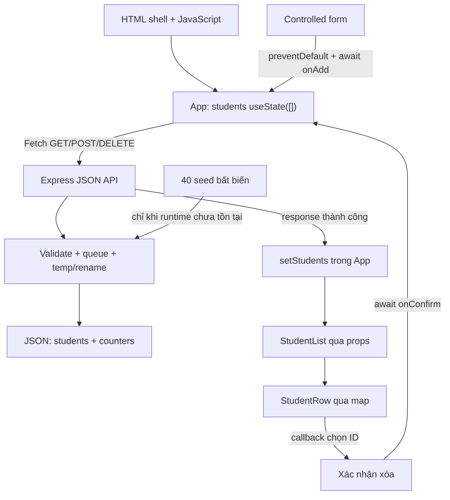

# Lựa chọn công nghệ và phân tích kiến trúc — Block4

**Phương án phù hợp với source hiện tại là React CSR + Vite + Express JSON API + JSON Persistence, dùng CSS thuần và model `id`, `name`, `email`, `className`, `major`.** React tạo Student List trong trình duyệt; Express nhận yêu cầu dữ liệu và lưu file. `App` là owner duy nhất của danh sách trong React, còn JSON runtime là nơi lưu bền vững qua F5 và restart backend.

Tài liệu này phân tích kiến trúc và các lựa chọn công nghệ đang được triển khai trong Block4. Chín phần dưới đây giải thích khái niệm, so sánh phương án, phân tích đánh đổi và đối chiếu bằng chứng dựa trên source, tài liệu yêu cầu và kết quả kiểm thử của Block4.

Nguồn đối chiếu: [package.json](package.json), [source React](src/App.jsx), [Express API](server/app.js), [JSON store](server/store.js), [phân tích đề](docs/ANALYSIS.md), [nghiệm thu](docs/ACCEPTANCE.md) và các artifact trong `docs/evidence/json-persistence/`. Phiên bản thư viện dưới đây lấy từ project, không được hiểu là phiên bản mới nhất. Kết quả thực nghiệm là kết quả đã lưu ngày 11/10/2026; phiên soạn tài liệu này không chạy lại build/test hoặc tạo bằng chứng mới.

## 1. Phân biệt công nghệ và phạm vi bắt buộc

| Khái niệm | Giải thích | Vai trò thực tế trong Block4 |
|---|---|---|
| React | Thư viện JavaScript tổ chức giao diện bằng component, props, state và event | Tạo form, bảng, dòng sinh viên và dialog tại trình duyệt |
| Vite | Công cụ phát triển và build frontend | Chạy dev server, xử lý JSX, build assets vào `dist`, proxy `/api` |
| Express | Web framework chạy trên Node.js | Cung cấp GET/POST/DELETE JSON API và phục vụ file build production |
| Template engine | Công cụ ghép dữ liệu với mẫu để tạo HTML | Block4 không cài EJS/Pug/Handlebars và không dùng `res.render` |
| CSR — Client-Side Rendering | Kết xuất giao diện bằng JavaScript phía trình duyệt | React nhận JSON rồi tạo Student List |
| SSR — Server-Side Rendering | Server tạo HTML chứa dữ liệu trước khi trả về | Mô hình dùng để đối chiếu; không phải cách bảng Block4 được tạo |
| JSON Persistence | Lưu dữ liệu có cấu trúc xuống file để dùng lại qua phiên | `data/students.json` giữ hồ sơ và bộ đếm MSSV |
| API — Application Programming Interface | Giao diện trao đổi giữa các phần mềm | Frontend gọi `/api/students` để đọc/thêm/xóa dữ liệu |

HTML là HyperText Markup Language, ngôn ngữ đánh dấu siêu văn bản; JSX là phần mở rộng cú pháp JavaScript để mô tả giao diện. JSX được Vite chuyển đổi, không phải HTML dữ liệu đã được Express render. HTTP là Hypertext Transfer Protocol, giao thức trao đổi request/response; JSON là JavaScript Object Notation, định dạng dữ liệu văn bản.

Việc có backend **không biến ứng dụng thành SSR**. `index.html` chỉ chứa `#root`, thông báo `noscript` và script khởi động. `main.jsx` gọi `createRoot`; `App` bắt đầu với `students=[]`, tải API trong effect và truyền dữ liệu cho bảng. Production Express phục vụ HTML shell/assets có sẵn trong `dist`, không ghép sinh viên vào HTML response.

Theo [đối chiếu PDF](docs/ACCEPTANCE.md), trọng tâm bắt buộc là Student List CSR, dữ liệu mẫu tương ứng bài SSR, controlled form, component/props/state/event và bốn tiêu chí: sinh viên mới xuất hiện; submit không tạo document mới; form reset sau thành công; danh sách có một owner. Bằng chứng gồm sơ đồ component, recording Add, Network trước/sau và mã nguồn để nhóm giải thích; demo khoảng 10 phút cần chỉ rõ owner và so sánh submit với SSR.

**Delete và JSON Persistence là phần mở rộng đã được nhóm lựa chọn**, không phải yêu cầu bắt buộc của PDF. Mô tả “không cần API/database” trong bài gốc cho phép giải pháp chỉ dùng state; source hiện tại bổ sung API để lưu bền vững. Dự án không có database, localStorage, sửa hồ sơ, tìm kiếm, phân trang hay đăng nhập.

## 2. So sánh phương án frontend và backend

So sánh cần xuất phát từ mục tiêu chứng minh CSR, khả năng giải thích của nhóm và source đang hoạt động. Template engine phục vụ SSR không thay thế được vai trò quản lý state và render giao diện của React trong bài này.

| Phương án | Học và trình bày | Component/state | Lưu qua F5/restart | Đánh đổi | Phù hợp Block4 hiện tại |
|---|---|---|---|---|---|
| **React + Vite + Express + JSON** | Cần hiểu hooks và Fetch; cùng JavaScript ở hai phía | Rõ owner, props, callback, immutable update | Có, qua API và JSON runtime | Thêm async, xử lý lỗi và hai server khi dev | **Cao nhất: đúng source và phần mở rộng** |
| React + Vite, chỉ state | Ít cấu hình hơn | Đáp ứng trọng tâm React/CSR | Không; state mất khi tải lại | Không thực hiện JSON Persistence hiện tại | Hợp bài gốc, thiếu mở rộng |
| JavaScript thuần + Fetch + Express | Ít cú pháp mới với nhóm biết DOM | Phải tự tổ chức render và đồng bộ dữ liệu | Có nếu dùng cùng store | Khó minh họa hooks/props; dễ sửa DOM rải rác | Không nên chuyển source sang cách này |
| Vue + Vite + Express | Template dễ đọc khi đã biết Vue | Có component và cơ chế reactive | Có nếu dùng API | Phải học hệ API khác, viết lại frontend React | Khả thi kỹ thuật, không có lợi cho source hiện tại |
| Express + EJS | Dễ với HTML/JavaScript | Không có React State điều khiển bảng | Có nếu dùng JSON | Server tạo bảng HTML; form truyền thống điều hướng | Phù hợp với yêu cầu SSR, không phải trọng tâm CSR |

Các nhận định trong bảng là đánh giá theo phạm vi bài tập và nền tảng nhóm, không phải xếp hạng chất lượng tuyệt đối. Không dùng điểm số giả định để khẳng định benchmark hiệu năng.

**Vì sao giữ React:** form, list và row được tách rõ; state dẫn đến render; callback đưa sự kiện về owner. Một nguồn state chung giúp các component phối hợp mà không tự giữ bản sao danh sách. Đây là cách tổ chức được mô tả trong [tài liệu React về chia sẻ state](https://react.dev/learn/sharing-state-between-components).

**Vì sao dùng Vite:** JSX cần bước chuyển đổi; dev server hỗ trợ phát triển và build tạo bộ static assets. Vite không phải kho dữ liệu và không cấp MSSV. Các vai trò dev/build được mô tả trong [hướng dẫn Vite](https://vite.dev/guide/). `vite.config.js` của project dùng JSX automatic, cổng dev 5173, preview 4173, `strictPort` và proxy API.

**Vì sao giữ Express:** frontend/backend cùng JavaScript, ba route gọn, JSON middleware và xử lý lỗi tập trung. Express 5 chuyển lỗi từ async handler trả Promise đến error middleware, phù hợp với các handler đang `await` store. [Tài liệu xử lý lỗi Express 5](https://expressjs.com/en/5x/guide/error-handling/).

| Gói | Phiên bản khai báo | Mục đích |
|---|---:|---|
| `react`, `react-dom` | 19.2.0 | Component/hooks và render DOM |
| `express` | 5.2.1 | JSON API, static assets, middleware lỗi |
| `vite` | 7.3.6 | Dev server, JSX và build |
| `playwright` | 1.57.0 | Browser/E2E và thu thập bằng chứng |

`package.json` yêu cầu Node.js `>=22.12.0`; môi trường của bằng chứng đã lưu là Node 24.18.0 trên Windows. Không cần Redux, router, Axios, ORM hoặc template engine cho một màn hình hiện tại. Nếu mở rộng nhiều trang hay dữ liệu lớn, cần đánh giá lại riêng, không tự thêm dependency chỉ để làm kiến trúc trông phức tạp.

## 3. Student Data Model — mô hình dữ liệu sinh viên

**Model đã triển khai có năm trường; `id` đồng thời là MSSV.** Không có trường `studentCode` riêng hoặc UUID cho hồ sơ. Người dùng nhập ba trường `name`, `email`, `className`; backend cấp `id` và suy ra `major` từ danh mục lớp.

| Trường | Kiểu và bắt buộc | Ý nghĩa | Nguồn giá trị/quy tắc |
|---|---|---|---|
| `id` | Chuỗi, có | MSSV và khóa định danh dòng | Backend cấp tám chữ số, bắt đầu bằng `0`; dùng làm React `key` và tham số DELETE |
| `name` | Chuỗi, có | Họ tên tiếng Việt | Trim, chuẩn hóa NFC, gộp khoảng trắng; 1–100 đơn vị độ dài chuỗi JavaScript |
| `email` | Chuỗi, có | Liên hệ và kiểm tra trùng | Trim, tối đa 254; so sánh duy nhất không phân biệt hoa/thường |
| `className` | Chuỗi, có | Mã lớp sinh hoạt | Phải thuộc `classes.json`; không nhập tùy ý |
| `major` | Chuỗi, có | Mã ngành | Lấy từ `selectedClass.majorCode`; hiển thị tên qua `majors.json` |

Ví dụ hồ sơ trong seed hiện tại:

```json
{
  "id": "02400001",
  "name": "Nguyễn Minh An",
  "email": "minh.an01@example.com",
  "className": "24CNTT1",
  "major": "CNTT"
}
```

Lưu MSSV dưới dạng chuỗi để giữ `0` đầu. Công thức cấp mã trong `createStudent` là `0` + khóa hai chữ số + số thứ tự năm chữ số. Lớp có `cohort="24"` dùng prefix `024`; mã tiếp theo lấy max giữa hồ sơ đang có và counter đã cấp, rồi cộng một. Seed khóa 24 có mã đến `02410010`, nên khi runtime mới khởi tạo từ seed, mã đầu tiên được cấp cho sinh viên khóa 24 là `02410011`. Trong các trạng thái runtime khác, mã tiếp theo phụ thuộc vào hồ sơ và counter đã lưu, không chỉ đếm số dòng đang còn.

Counter được lưu cùng JSON và **không giảm khi xóa**. Xóa mã lớn nhất, xóa hết hồ sơ hoặc restart không làm tái cấp mã đã dùng. Khi số thứ tự đã đạt 99999, khóa đó từ chối thêm; khóa khác vẫn có thể cấp mã. Đây là quy ước ứng dụng phục vụ bài tập, không khẳng định là quy định MSSV chính thức của trường.

| Model | Lợi ích | Hạn chế/chi phí | Quyết định |
|---|---|---|---|
| Tối giản: `id`, `name`, `email` | Bám ba trường trọng tâm đề | Không biểu diễn lớp/ngành hoặc suy khóa theo lớp | Không phải source hiện tại |
| **Hiện tại: năm trường** | Biểu diễn đầy đủ lớp/ngành, form ngắn, ngành nhất quán với lớp | ID gắn quy ước MSSV; danh mục phải được bảo trì | Giữ nguyên |
| Mở rộng: thêm ID kỹ thuật, ngày nhập học, trạng thái học vụ | Hỗ trợ nghiệp vụ phức tạp hơn | Đổi schema, API, UI, migration và test | Chưa cần |

Danh mục thực tế có **10 lớp và 4 ngành**: `CNTT` — Công nghệ thông tin; `KHDL` — Khoa học dữ liệu; `TOAN` — Toán học; `VL` — Vật lý. Có các lựa chọn `24C11` và `24CNTT` bên cạnh các lớp dùng trong seed. Lớp sinh hoạt là lớp quản lý hành chính, không phải lớp học phần. Không thêm dữ liệu cá nhân như căn cước, địa chỉ hoặc gia đình vì không phục vụ luồng hiện có.

## 4. Validation — kiểm tra tính hợp lệ của dữ liệu

Validation phía client giúp phản hồi sớm, nhưng backend kiểm tra lại với dữ liệu runtime mới nhất trong hàng đợi. Không tin danh sách client để bảo đảm duy nhất: tab khác hoặc request trực tiếp có thể làm trạng thái client cũ.

Hàm dùng chung nằm trong [src/utils/student.js](src/utils/student.js). `validateStudentInput` chỉ nhận object có đúng ba trường chuỗi được cho phép; reject mảng, thiếu trường, sai kiểu và trường lạ như `id`, `major` hoặc đường dẫn file. Không spread toàn bộ request body vào hồ sơ.

| Nhóm | Hành vi đang có | Khi không hợp lệ |
|---|---|---|
| `name` | Trim → NFC → gộp `\s+` thành một khoảng trắng; không rỗng, dài tối đa 100 | Thông báo độ dài; không ghi JSON |
| `email` | Trim, tối đa 254, regex `^[^\s@]+@[^\s@]+\.[^\s@]+$` | Báo email không hợp lệ |
| Email trùng | So `toLowerCase()` với hồ sơ đã lưu | HTTP 409; giữ input |
| `className` | Khớp chính xác mã trong danh mục | Báo chọn lớp hợp lệ |
| `major` | Không nhận từ request; suy ra theo lớp | Gửi thêm trường này bị từ chối |
| `id` | Không nhận từ request; server cấp trong thao tác lưu | Gửi ID thủ công bị từ chối |
| Body | Express JSON parser, giới hạn `16kb` | JSON malformed: 400; quá lớn: 413 |
| Runtime | Kiểm tra schema, hồ sơ, ID/email duy nhất, lớp/ngành/khóa và counter | Báo lỗi; không tự reseed |

NFC là Normalization Form C, dạng chuẩn hóa Unicode tổ hợp. `"  Nguyễn   Thị Ánh  "` được lưu thành `"Nguyễn Thị Ánh"`. Tên có dấu nháy hoặc gạch nối không bị một regex chỉ chữ cái loại bỏ. Tuy nhiên, hàm hiện tại không phải bộ kiểm tra toàn bộ ký tự điều khiển; giới hạn 100 dùng `.length`, không đếm grapheme hiển thị. Không mô tả những kiểm tra chưa có như đã triển khai.

Email được lưu với cách viết sau trim, **không tự chuyển tên miền hoặc toàn bộ địa chỉ sang chữ thường**. Chỉ phép so sánh trùng dùng chữ thường theo chính sách ứng dụng. Regex hiện tại là kiểm tra đơn giản: không bảo đảm toàn bộ chuẩn email, không kiểm tra hộp thư tồn tại, và không có các luật riêng về dấu chấm ở local part hay dấu gạch nối ở nhãn domain. Không khẳng định các quy tắc kiểm tra email chặt hơn đã được triển khai.

`AddStudentForm` có `required`, `maxLength`, `type="email"` nhưng form dùng `noValidate`, nên thông báo submit dựa vào validation JavaScript dùng chung thay vì hộp báo lỗi native. Lỗi đang hiển thị chung bằng `role="alert"`; chưa có hệ thống lỗi riêng cho từng field hoặc tự focus field lỗi.

XSS là Cross-Site Scripting, tấn công chèn mã vào trang. Dữ liệu được đưa vào biểu thức JSX để hiển thị văn bản; source không dùng `dangerouslySetInnerHTML` cho hồ sơ. Validation không thay thế việc hiển thị dữ liệu an toàn, và không đồng nghĩa hệ thống đã có xác thực/phân quyền.

| Tình huống API | Status và nội dung thực tế |
|---|---|
| GET thành công | 200, mảng sinh viên JSON |
| POST thành công | 201, hồ sơ do server cấp sau khi lưu xong |
| Input không hợp lệ/hết phạm vi mã | 400, `{ "error": "..." }` |
| Email trùng | 409, JSON lỗi |
| DELETE thành công | 200, `{ "id": "..." }` |
| ID DELETE sai/không tồn tại hoặc API không tồn tại | 404, JSON lỗi |
| JSON malformed/body quá lớn | 400/413, JSON lỗi |
| Lỗi đọc/ghi | 500, thông báo chung; chi tiết lỗi storage ghi phía backend |

Không có luồng POST → 303 trong Block4. Source cũng không có nhánh 415 chuyên biệt, nên không suy diễn rằng mọi Content-Type không hỗ trợ đều được trả 415. API đặt `Cache-Control: no-store` cho các request đi qua middleware `/api`.

## 5. Lưu trữ bằng JSON file

UTF-8 là cách mã hóa Unicode để giữ văn bản tiếng Việt. **Seed và runtime là hai loại file khác nhau:** [students.seed.json](src/data/students.seed.json) là mảng 40 hồ sơ cố định; `data/students.json` là object runtime có version, danh sách và metadata cấp mã.

Schema minh họa sau không thay thế seed thật:

```json
{
  "version": 1,
  "students": [],
  "counters": { "024": 10010, "025": 10, "026": 10 }
}
```

Mảng rỗng với counter hợp lệ là trạng thái có thể tồn tại sau khi xóa hết. Không seed lại chỉ vì danh sách rỗng. Các counter tương ứng prefix danh mục phải là số nguyên, không thấp hơn mã còn trong danh sách và không vượt 99999.

| Cách lưu | Qua F5 | Qua backend restart | Chi phí và giới hạn |
|---|---|---|---|
| React State | Không | Restart riêng backend không tự xóa state đang có trong tab trình duyệt | Không phải dữ liệu lưu bền vững; đơn giản, phù hợp demo CSR cơ bản |
| localStorage | Có trong cùng trình duyệt | Không phụ thuộc backend | Không có kho chung; client có thể sửa; không dùng trong source |
| **JSON file backend** | Có, khi GET lại | Có | Dễ xem dữ liệu; tự lo schema, duy nhất và ghi đồng thời |
| SQLite/database | Có | Có | Có cơ chế lưu/giao dịch chuyên biệt, nhưng đổi triển khai và test |

JSON phù hợp vài chục hồ sơ trong bài tập và một backend. Mỗi lần truy cập đọc/parse/validate toàn bộ file; mỗi thay đổi ghi lại toàn bộ document. Không có index, transaction database hay khóa giữa các tiến trình.

**Khởi tạo:** `server/index.js` đợi `store.initialize()` trước khi listen. Có runtime hợp lệ thì chỉ đọc; chưa có file (`ENOENT`) thì tạo từ seed và `getSequenceCounters(seed)`. JSON hỏng, schema sai hoặc không đọc được thì startup báo lỗi, giữ runtime. Khởi tạo dùng hard link từ file tạm để không overwrite đích vừa được tạo bởi tiến trình khác; việc này không có nghĩa hỗ trợ nhiều backend ghi đồng thời.

**Một thao tác thêm được lưu như sau:**

1. Xếp toàn bộ thao tác vào hàng đợi Promise của store.
2. Đọc và validate document mới nhất từ runtime.
3. Kiểm tra input/email trùng, cấp MSSV từ hồ sơ và counters.
4. Tạo document mới bằng spread, cập nhật counter cùng hồ sơ.
5. Ghi JSON UTF-8 vào file tạm cùng thư mục với tên UUID; `flag: 'wx'`, `flush: true`.
6. Rename file tạm thành runtime; dọn file tạm trong `finally`.
7. Sau khi lưu hoàn tất, API mới trả 201; frontend mới cập nhật state.

DELETE cũng đọc–validate–lọc–lưu trong hàng đợi, giữ nguyên counter. GET được tuần tự hóa cùng thao tác ghi. Một Promise lỗi được catch ở queue để không khóa các request kế tiếp. Hàng đợi bao trùm **đọc–kiểm tra–sửa–ghi**, tránh hai POST cùng dùng snapshot cũ. Tài liệu Node lưu ý không ghi đồng thời vào cùng file khi chưa chờ thao tác trước hoàn tất. [Tài liệu filesystem Node.js](https://nodejs.org/api/fs.html).

| Sự cố | Xử lý thực tế/giới hạn |
|---|---|
| File chưa tồn tại lúc khởi động | Tạo từ 40 hồ sơ seed của dự án |
| File đã có/rỗng hợp lệ | Giữ dữ liệu và counters; không overwrite bằng seed |
| Runtime hỏng lúc startup | Không mở server thành công; giữ bytes để khôi phục |
| Runtime hỏng giữa phiên | API lỗi; frontend không giả vờ tải seed |
| Ghi/rename thất bại | API không xác nhận thành công; test injected rename failure kiểm tra giữ runtime cũ |
| Mất kết nối sau server commit | UI có thể chưa nhận ack; tải lại đối chiếu trước khi thử lại |
| Nhiều backend cùng dùng một file | Không hỗ trợ; queue chỉ trong một store/process |
| Mất điện hoặc crash tại từng bước | Chưa được kiểm thử; temp/flush/rename không thay thế backup |

`STUDENT_DATA_FILE` là cấu hình khởi động, không phải trường API. `resolveDataFile` giới hạn đường dẫn `.json` trong `data/` hoặc `.tools/test-data/` của project. Runtime và file tạm được `.gitignore`; seed/danh mục vẫn là source theo dõi bằng Git. Không có endpoint reset. Hướng dẫn backup/khôi phục và demo bằng file test riêng nằm trong [JSON_PERSISTENCE.md](docs/JSON_PERSISTENCE.md).

**Bộ mẫu hiện tại có 40 sinh viên:** 20 thuộc khóa 24, 10 khóa 25, 10 khóa 26; bốn ngành có 10 hồ sơ mỗi ngành. ID/email duy nhất; email thuộc `example.com`; họ tên có dấu. Đây là dữ liệu giả lập. File seed là nguồn dữ liệu khởi tạo chuẩn; mã sinh viên hiện tại là MSSV tám chữ số. Danh mục có 10 lớp nhưng seed dùng 8 lớp; hai lớp bổ sung vẫn được phép chọn khi thêm.

## 6. Giao diện UI/UX

UI là User Interface, giao diện người dùng; UX là User Experience, trải nghiệm người dùng. Source hiện tại dùng phong cách học vụ: header navy, điểm nhấn teal, nền xám sáng, panel trắng và font hệ thống `Segoe UI` hỗ trợ tiếng Việt. Không cần tải font/CDN hoặc bộ component bên ngoài để chạy demo.

| Khu vực | Hành vi hiện tại | Lợi ích |
|---|---|---|
| Header/đầu trang | Tiêu đề, mô tả, tổng sinh viên | Nhận biết màn hình và số lượng |
| Loading/error | Thông báo tải; GET lỗi có nút “Thử lại” | Phân biệt chưa tải được với danh sách rỗng |
| Form thêm | Popover, ba input/chọn lớp, chú thích MSSV/ngành tự xác định | Ít nhập liệu, giảm mâu thuẫn lớp/ngành |
| Bảng | MSSV, tên, email, lớp, ngành, thao tác xóa | Xem đầy đủ model; `key={student.id}` ổn định |
| Thành công | Thông báo mã mới/xóa; dòng mới tô nền và cuộn đến | Dễ quan sát kết quả submit |
| Xác nhận xóa | Native modal dialog, hiện hồ sơ, focus “Hủy” khi mở | Giảm nhầm hồ sơ và Enter vô ý |
| Danh sách rỗng | Thông báo và hướng dẫn thêm đầu tiên | Có hành động rõ khi không còn hồ sơ |

Form dùng `value/onChange` gắn với state `values`, tức controlled inputs. Khi lưu, input/nút bị khóa, `aria-busy` phản ánh pending. Ref ngăn submit lặp ngay trước render kế tiếp. Thành công thì reset `EMPTY_FORM` và đóng popover nếu hỗ trợ; lỗi giữ nội dung đã nhập. Delete lỗi giữ dialog và dòng sinh viên; Hủy/Escape không gửi yêu cầu xóa khi chưa lưu.

Trên màn hình nhỏ, bảng có vùng cuộn ngang riêng; form/dialog có CSS điều chỉnh theo viewport. Popover có fallback điều hướng đến vùng form bằng liên kết khi CSS không hỗ trợ `:popover-open`; fallback này hỗ trợ cách mở form, không làm ứng dụng hoạt động khi tắt JavaScript. Delete vẫn dùng native `dialog`, cần trình duyệt hỗ trợ.

Các điểm accessibility đã có: skip link, HTML ngữ nghĩa, label/input liên kết, caption và `scope` cho bảng, vùng cuộn focus được, tên nút xóa chứa tên/MSSV, status/alert và focus mặc định ở Hủy. Chưa có bằng chứng kiểm thử screen reader, mọi trình duyệt hoặc audit accessibility đầy đủ; không kết luận đạt WCAG chỉ từ markup.

| Phương án style | Lợi ích | Chi phí | Quyết định |
|---|---|---|---|
| **CSS thuần hiện tại** | Chủ động bố cục, ít dependency, dễ giải thích | Tự bảo trì responsive/focus/pending | Giữ nguyên |
| Bootstrap | Có sẵn quy ước form/table/grid | Thêm style framework và điều chỉnh giao diện hiện có | Chưa có lý do chuyển |
| Tailwind | Thuận tiện với nhóm quen utility class | Thêm quy trình và đổi nhiều JSX/class | Chưa cần cho một màn hình |

Nếu phát triển tiếp, lỗi riêng tại field và focus field lỗi là cải thiện hợp lý. Đó là đề xuất tương lai, không nằm trong thay đổi tài liệu này.

## 7. Cấu trúc thư mục và trách nhiệm hiện tại

```text
Web-Block4/
├── index.html                       # HTML shell, root và script
├── src/
│   ├── main.jsx                     # createRoot, StrictMode, CSS
│   ├── App.jsx                      # owner students, GET/Add/Delete
│   ├── api/students.js               # Fetch, timeout và lỗi API
│   ├── components/
│   │   ├── SiteHeader.jsx
│   │   ├── AddStudentForm.jsx
│   │   ├── StudentList.jsx
│   │   ├── StudentRow.jsx
│   │   └── DeleteStudentDialog.jsx
│   ├── utils/student.js             # validation/cấp mã dùng chung
│   ├── data/{students.seed,classes,majors}.json
│   └── styles.css
├── server/
│   ├── index.js                     # initialize, listen, shutdown
│   ├── app.js                       # middleware, routes, static, lỗi
│   └── store.js                     # schema, queue, đọc/ghi runtime
├── data/.gitkeep                    # students.json sinh khi chạy
├── public/                          # assets tĩnh
├── tests/                           # unit/API/browser/E2E/evidence
├── docs/                            # phân tích, demo, nghiệm thu
│   └── evidence/json-persistence/   # artifact phiên bản có backend
├── vite.config.js
├── package.json, package-lock.json
├── README.md, .gitignore
└── codex_tech_choice_block4.md       # phân tích công nghệ Block4
```

`dist/` và `node_modules/` là output build/dependency, được gitignore. `data/students.json` chỉ có khi backend khởi tạo runtime; sơ đồ không khẳng định file đó đã tồn tại trong workspace chưa chạy backend.

| Thành phần | State/props và trách nhiệm |
|---|---|
| `App` | `students` duy nhất; loading/error/retry, ID thông báo và pendingDeleteId; gọi API, cập nhật danh sách |
| `AddStudentForm` | `values`, `error`, `submitting`; nhận `onAdd`, không giữ bản sao students |
| `StudentList` | Nhận students/createdId/callback, `map` thành các row |
| `StudentRow` | Nhận một student và callback; render, scroll khi mới thêm |
| `DeleteStudentDialog` | Nhận student/onConfirm/onCancel; state lỗi/pending riêng, không tự lọc list |
| `src/api/students.js` | URL, method, JSON body, timeout 10 giây và thông báo kết nối |
| `server/app.js` | HTTP status/JSON response; không render Student List |
| `server/store.js` | Kho dữ liệu bền vững, đọc lại runtime, tuần tự hóa và xác nhận ghi |

`pendingStudent` được `find` từ students, không phải state chứa danh sách thứ hai. `createdId`/`deletedId` là metadata; `mutationBusy` là ref khóa thao tác, không phải kho sinh viên. File JSON của server là nguồn lưu bền vững; quy tắc “một owner” áp dụng cho danh sách React dùng trực tiếp để render.

Lệnh chạy từ thư mục project trên PowerShell:

```powershell
# Nếu cần cài theo lockfile:
npm.cmd ci

# Development: hai terminal riêng
# Terminal 1
npm.cmd run backend
# Terminal 2
npm.cmd run dev

# Production: sau khi dừng các server dùng cùng cổng
npm.cmd run build
npm.cmd start
```

Dev truy cập `http://127.0.0.1:5173`, backend mặc định `http://127.0.0.1:3004`. Proxy `/api` giữ request cùng origin từ phía trình duyệt, nên cấu hình hiện tại không cần CORS riêng. Nếu đổi `PORT` của backend, đặt `API_PORT` tương ứng ở terminal Vite. Production truy cập cổng 3004; `npm.cmd run preview` dùng 4173 và vẫn cần backend, không thay thế `npm.cmd start`. Backend bind `127.0.0.1`, phù hợp chạy local.

## 8. Luồng xử lý, rủi ro và cách kiểm chứng



**Load:** trình duyệt nhận shell/script → React mount → effect gọi GET → nhận mảng → `setStudents(data)` → list/row render. Cleanup abort request khi effect kết thúc; retry tăng `loadAttempt`. StrictMode ở development có thể chạy thêm vòng effect/cleanup, nên không dùng số GET dev để kết luận submit reload. Network filter **Doc** mới trực tiếp kiểm chứng document navigation.

**Add:** input đổi state form → submit `preventDefault()` → callback `onAdd` → client validate → Fetch POST → backend đọc/validate/cấp mã/lưu JSON → 201 student → `setStudents(current => [...current, student])` → form reset. Không tạo ID ở client và không cập nhật danh sách trước ack.

**Delete:** row gọi callback ID → App xác định hồ sơ → dialog xác nhận → Fetch DELETE → backend lưu document đã lọc → response → `setStudents(current => current.filter(student => student.id !== id))` → đóng dialog/thông báo. Nhấn Hủy chỉ thay metadata dialog, không thay students hoặc JSON.

Spread và `filter` tạo mảng mới; không dùng `push`/`splice` để sửa state trực tiếp. Functional updater nhận state gần nhất khi response đến. Cách cập nhật này phù hợp [hướng dẫn React về immutable array state](https://react.dev/learn/updating-arrays-in-state).

| Điểm so sánh | Ví dụ SSR sử dụng Express + EJS | Block4 CSR hiện tại |
|---|---|---|
| Nơi tạo bảng | Server render EJS thành HTML | React render trong trình duyệt |
| Response ban đầu | HTML đã chứa hồ sơ | Shell, rồi GET JSON |
| Submit thêm | Ví dụ PRG: POST form → 303 → GET trang | `preventDefault` → Fetch POST → 201 JSON → state |
| Network khi thêm | Có document navigation theo luồng form | Fetch/XHR tăng, Doc không tăng trong submit |
| Khi F5 | Server render lại HTML từ kho | App mới gọi GET runtime rồi render |
| JavaScript tắt | SSR có thể cung cấp bảng/form truyền thống | Block4 cần JavaScript; có noscript hướng dẫn |
| Lưu bền vững | Kho server của bài SSR | JSON store sau API, độc lập nơi render |

PRG là Post/Redirect/Get, luồng chuyển hướng sau POST của bài SSR. Fetch không đồng nghĩa “không gửi request”: Block4 vẫn có POST/DELETE đến backend, chỉ không tải lại toàn bộ document. F5 do người dùng chủ động tạo document mới là bình thường và phải tách khỏi cửa sổ đo submit.

| Rủi ro | Biện pháp đang có | Giới hạn cần hiểu |
|---|---|---|
| API lỗi/mất kết nối | Timeout, thông báo, GET retry; giữ input/dòng khi ghi lỗi | Timeout có thể xảy ra sau backend đã lưu |
| Click/Enter liên tiếp | Pending/disabled + ref khóa ở form/dialog/App | Không phải idempotency cho mọi client |
| Client cũ gửi email trùng | Backend kiểm tra trong queue với file mới nhất | Tab không tự đồng bộ với tab khác |
| POST đồng thời mất hồ sơ | Queue toàn bộ read–modify–write | Chỉ trong một backend/store |
| File hỏng hoặc ghi dở | Validate, file tạm/flush/rename, không auto-reseed | Không bảo đảm mọi crash/mất điện |
| Xóa rồi cấp lại MSSV | Counter lưu bền vững, không giảm | Mỗi khóa có phạm vi hữu hạn |
| Mất `0` đầu/tên có dấu | Chuỗi MSSV và UTF-8/NFC | Quy ước mã là của ứng dụng |
| File runtime kích hoạt dev reload | Vite watch ignore runtime/temp/test/evidence | Cần kiểm chứng bằng Doc, không chỉ nhìn màn hình |
| Test làm đổi dữ liệu thật | Fixture dùng `.tools/test-data` riêng | Không chạy suite tạo file trong phiên chỉ sửa tài liệu |

**Bằng chứng đã có, không phải test vừa chạy:** [final-summary.json](docs/evidence/json-persistence/final-summary.json) ghi kết quả ngày 11/10/2026, môi trường cũ có đường dẫn `D:\VSCode\HCMUS\Web\Block4`. Workspace hiện tại ở đường dẫn khác; các artifact đó không chứng minh đã chạy lại tại đường dẫn mới.

| Bộ kiểm chứng | Kết quả ghi nhận | Artifact |
|---|---|---|
| Unit | 14 pass, 0 fail | [unit-api-output.txt](docs/evidence/json-persistence/unit-api-output.txt) |
| API/backend | 12 pass, 0 fail | [unit-api-output.txt](docs/evidence/json-persistence/unit-api-output.txt) |
| Browser dev | 23 nhóm PASS, không lỗi bất ngờ | [dev/browser-results.json](docs/evidence/json-persistence/dev/browser-results.json) |
| Browser production | 23 nhóm PASS, không lỗi bất ngờ | [production/browser-results.json](docs/evidence/json-persistence/production/browser-results.json) |
| E2E persistence | 10 nhóm PASS, restart Chrome và Express thực tế | [e2e/results.json](docs/evidence/json-persistence/e2e/results.json) |
| Build | PASS, 38 modules | [build-output.txt](docs/evidence/json-persistence/build-output.txt) |
| State owner | Quan sát App state 40 → 41 | [react-state-log.json](docs/evidence/json-persistence/react-state-log.json) |
| Network/capture lịch sử | Doc Add/Delete 1 → 1; ảnh/log cũ giữ nguyên, không xác minh thay MP4 | [ảnh/log](docs/evidence/json-persistence/recording/) |
| Recording chính thức | MP4 do người dùng quay bằng Chrome/OBS; phạm vi đã xác minh xem EVIDENCE.md | [add-student.mp4](docs/evidence/add-student.mp4) |

Unit tests kiểm tra seed, chuẩn hóa, cấp mã/counter, immutable update, thiếu/sai kiểu và trùng email. API tests kiểm tra 201 sau ghi, 20 POST đồng thời không mất hồ sơ, cùng email chỉ tạo một, DELETE/404, runtime hỏng, rename failure và restart giữ counter. Browser tests kiểm tra UI/validation, pending, failure, form reset, dialog và viewport 1440/390/320. Injected HTTP 500 hoặc lỗi rename là lỗi được tạo có chủ đích để kiểm tra xử lý, không phải lỗi bất ngờ.

Chuỗi E2E đã lưu: 40 → Add 41 → đối chiếu JSON → F5 41 → Chrome mới 41 → Delete 40 → đối chiếu JSON → F5 40 → restart backend/F5 vẫn 40 và counter đã tăng. Trong cửa sổ Add, Doc 1 → 1; trong cửa sổ Delete của E2E, Doc 3 → 3 vì trước đó đã có F5. So sánh trước/sau cùng cửa sổ quan trọng hơn giá trị tuyệt đối.

Các lệnh để tái kiểm chứng khi có một phiên cho phép tạo artifact: `npm.cmd test`, `npm.cmd run test:browser:dev`, `npm.cmd run test:browser:production`, `npm.cmd run test:e2e`, `npm.cmd run build`. Không chạy chúng trong phiên tài liệu này để giữ phạm vi hai file.

Chỉ giữ một recording chính thức là `docs/evidence/add-student.mp4`. WebM tự động đã được loại bỏ; JSON/log/video-validation của phiên cũ là lịch sử, không mô tả MP4. Script evidence:capture chỉ tạo screenshot/log, không quay video hoặc ghi đè MP4.

**Chưa kiểm chứng:** buổi thuyết trình/nộp bài thực tế; React DevTools extension; Firefox/Safari; thiết bị vật lý/screen reader; mất điện/crash từng bước; filesystem khác; nhiều backend ghi cùng file; video Delete riêng. Sơ đồ, source và artifact hỗ trợ nhóm giải thích, không thay thế việc nhóm tự trình bày trước giảng viên.

## 9. Quyết định hiện tại và hướng mở rộng

Các lựa chọn cốt lõi đã được thể hiện trong source Block4 và được dùng làm căn cứ của tài liệu này, thay vì trình bày như các phương án còn chờ triển khai.

| Quyết định | Phương án hiện tại | Lý do/đánh đổi |
|---|---|---|
| Rendering | React CSR | Đáp ứng mục tiêu component/state/event và không navigation khi submit |
| Tooling | Vite | Dev/build JSX gọn, proxy API rõ |
| Backend | Express JSON API | Lưu bền vững mà React vẫn render bảng |
| Model | Năm trường; `id` là MSSV | Giữ dữ liệu học vụ và giảm trường nhập |
| Cấp mã | Backend theo khóa + counter | Tránh mã trùng/tái sử dụng sau xóa/restart |
| Lớp/ngành | Lớp chọn từ danh mục, ngành suy ra | Giữ quan hệ nhất quán |
| Email | Duy nhất khi so không phân biệt hoa/thường | Hạn chế thêm trùng; không xác minh hộp thư |
| Giao diện | CSS thuần, popover/dialog | Ít dependency và đủ tương tác cho một trang |
| Storage | Seed bất biến + runtime JSON version 1 | Dễ demo/giải thích; giới hạn một backend/file |
| Mutation UI | Chờ backend lưu thành công rồi đổi state | Không báo thành công sớm; cần pending/error |
| Phạm vi | List/Add là cốt lõi; Delete/Persistence là mở rộng | Không gán chức năng mở rộng thành yêu cầu PDF |

Nếu mở rộng thực tế, thứ tự ưu tiên là: lỗi theo field và kiểm thử accessibility; đồng bộ nhiều tab/refetch khi xung đột; backup/khôi phục được kiểm tra; chuyển database khi cần nhiều writer hoặc dữ liệu lớn; xác thực/phân quyền khi triển khai phục vụ người dùng ngoài local. Mỗi bước làm thay đổi phạm vi, API hoặc cách vận hành và cần thiết kế riêng; tài liệu không khẳng định các tính năng đó đã có.

Đối với bài tập hiện tại, nhóm cần giải thích được ba mối quan hệ: **state → props → UI; event → callback → owner; API ack sau lưu → immutable state update**. Khi so với mô hình SSR, hãy dùng HTML response và Network Doc để chỉ ra nơi tạo bảng và cách submit, rồi dùng JSON/F5/restart để chứng minh persistence là vấn đề khác với rendering. [DEMO.md](docs/DEMO.md) và [CODE_EXPLANATION.md](docs/CODE_EXPLANATION.md) cung cấp kịch bản và phần mã cần trình bày.