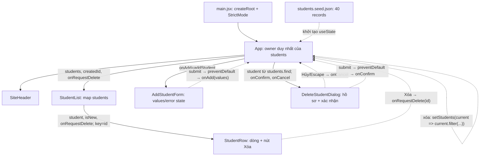

# Evidence 1 - Component và state owner

Delete là phần mở rộng của người dùng, không thêm yêu cầu nghiệm thu vào PDF.

App kiểm tra/cấp ID khi thêm và lọc theo ID khi xác nhận xóa. List truyền tiếp callback xóa đến Row, không sửa dữ liệu. Dialog cũng chỉ gọi callback; mở hộp thoại chưa xóa hồ sơ. Form reset khi onAdd trả chuỗi rỗng và giữ values nếu có lỗi.

| Dữ liệu | Owner | Mục đích |
|---|---|---|
| students | App | Danh sách state chính thức duy nhất |
| createdId/deletedId | App | Chuỗi MSSV cho thông báo/highlight |
| pendingDeleteId | App | MSSV đang chờ xác nhận; Hủy/Escape đặt lại chuỗi rỗng |
| pendingStudent | Không có state riêng | Tính từ students.find trong mỗi render của App |
| issuedCounters | App, useRef | Số thứ tự cao nhất đã cấp theo khóa; không chứa hồ sơ/danh sách; không giảm khi xóa |
| values/error | AddStudentForm | Dữ liệu form và lỗi đầu vào |
| rowRef/panelRef/dialogRef/cancelRef | Component tương ứng | Tham chiếu DOM để cuộn/đóng popup/mở dialog/focus Hủy |

Props đi từ cha xuống con; con gọi callback nhận qua props để đề nghị owner thay đổi dữ liệu. Không có students state trong component con, Context, Redux, localStorage hoặc module store. JSON seed là input ban đầu. Native popover quản lý mở/đóng form; native dialog giữ focus trong hộp thoại; React quản lý nội dung và event.
