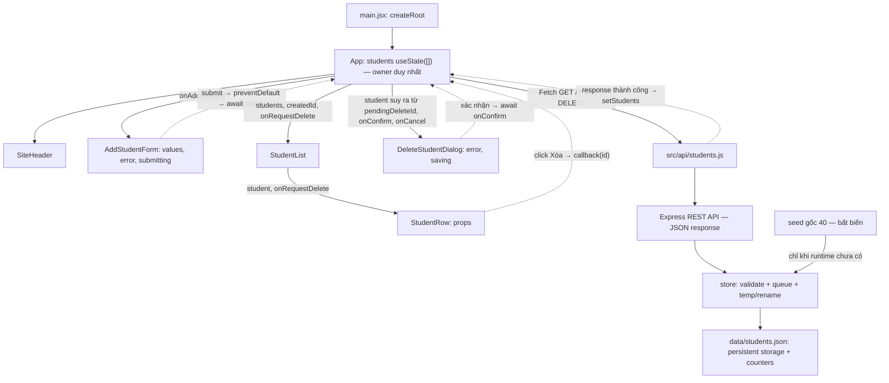

# Evidence 1 — Component diagram và state owner

React State là nguồn trực tiếp của JSX. JSON là storage bền vững; counters chỉ nằm ở backend, không phải một danh sách React State khác.

| Component | State/props và vai trò |
|---|---|
| App | students duy nhất; loading/loadError/loadAttempt; createdId/deletedId/pendingDeleteId là metadata. mutationBusy ref khóa ghi UI; pendingStudent được find từ students. |
| AddStudentForm | values liên kết value/onChange; error/submitting; gọi callback onAdd, chỉ reset khi callback thành công. |
| StudentList | map students nhận qua props; không giữ bản sao list. |
| StudentRow | render năm trường + nút Xóa; callback chuyển ID lên List/App. |
| DeleteStudentDialog | student props, error/saving cục bộ; confirm/cancel callbacks; không tự xóa list. |
| SiteHeader | Header/nav cố định, không quản lý students. |

GET: [] → danh sách đã lưu. Add: current → [...current, student]. Delete: current → current.filter(...). Cả hai chỉ cập nhật sau JSON lưu thành công. F5 tạo App mới, GET nạp runtime thay vì trở về seed.
